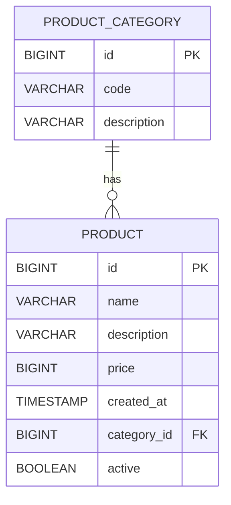
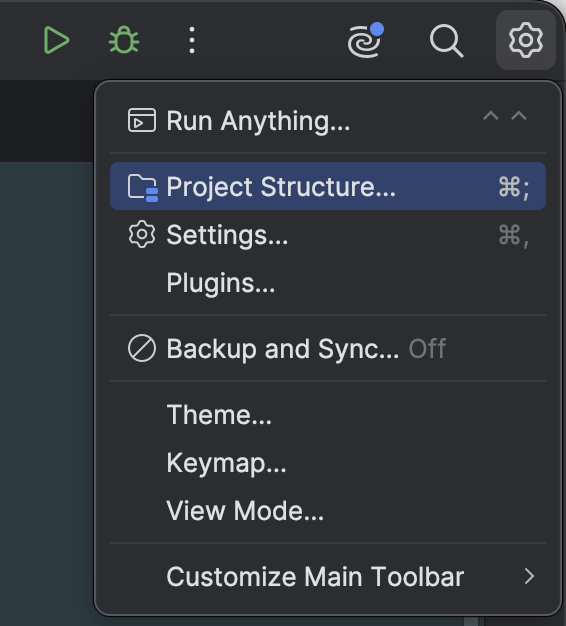
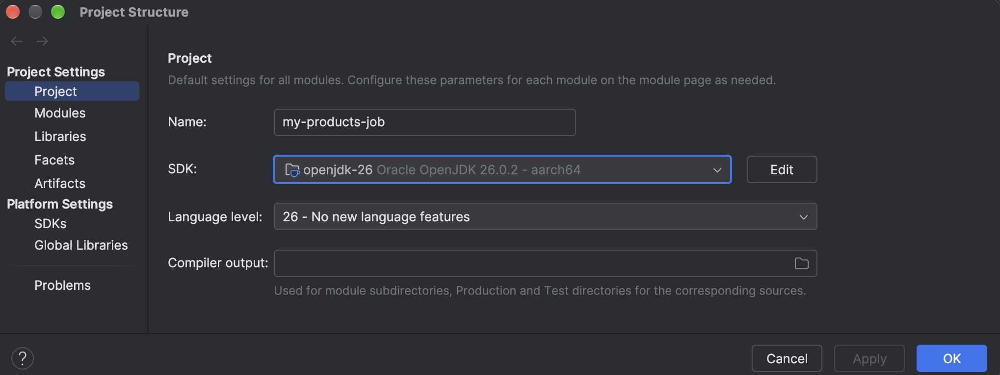
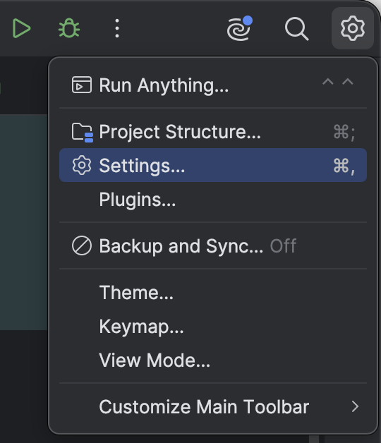
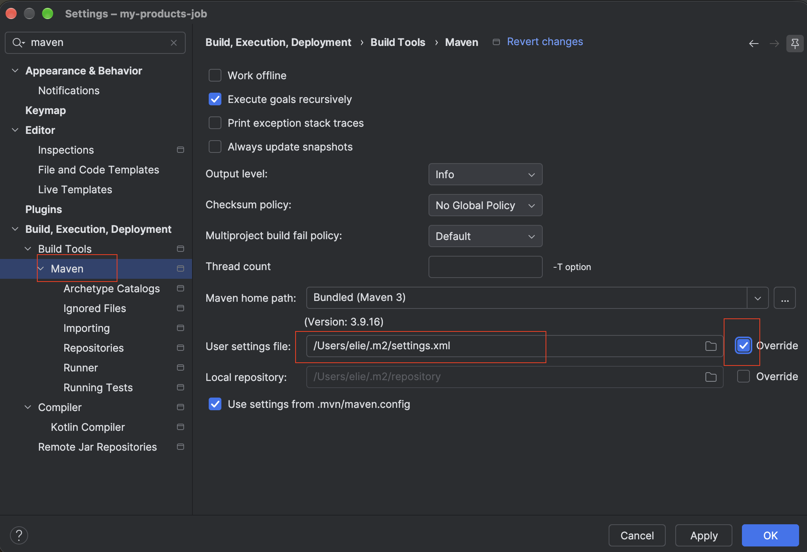
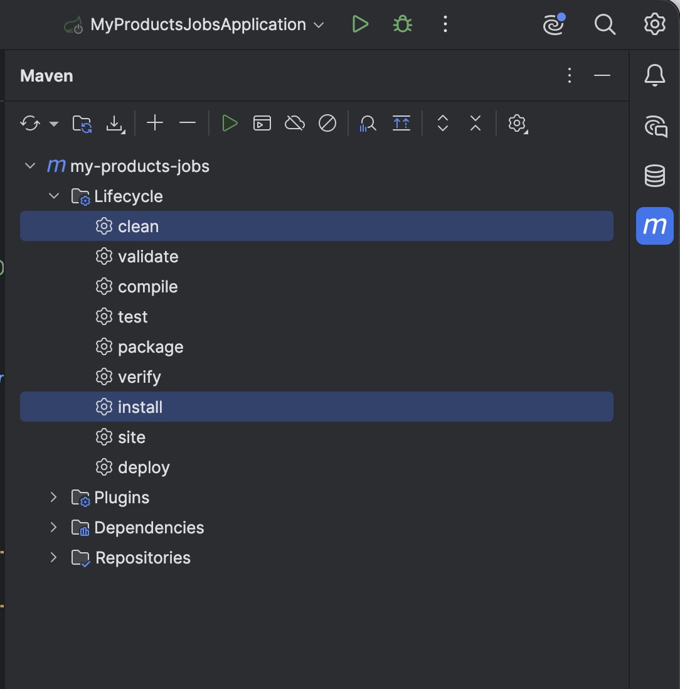
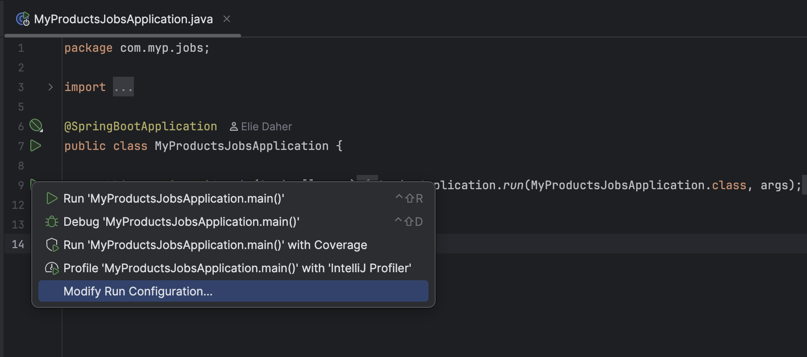
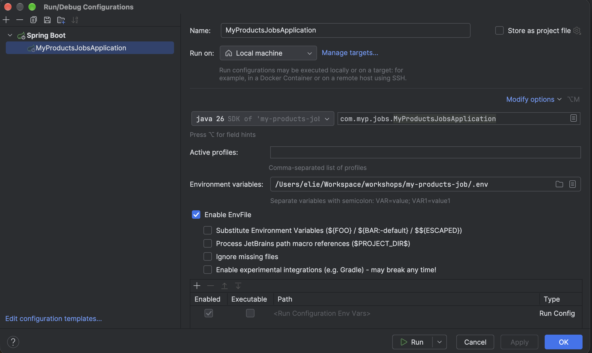

## My Products



Already there is a `Job` configured that contains a dummy `Tasklet` step.

Clone project and open in IntelliJ IDEA 

## Specify path of the SDK

- Click on Project Structure 



- Specify SDK path and apply changes



If you need to use other java version, don't forget to change `java.version` in `pom.xml`

## Override maven `setting.xml`

- Click on Settings



- Override maven `settings.xml` file



## Compile project



## Create `.env` at the root with the following information 

```properties
DB_HOST=...
DB_PORT=...
DB_NAME=...
DB_USERNAME=...
DB_PASSWORD=...
DB_SCHEMA=...
```

## Modify run configuration



- Modify options to add Environment variables
- Specify .env path as environment variable



## Run application 

Make sure liquibase is well executed on your schema 

## Open swagger to discover project 

http://localhost:8080/swagger-ui/index.html
