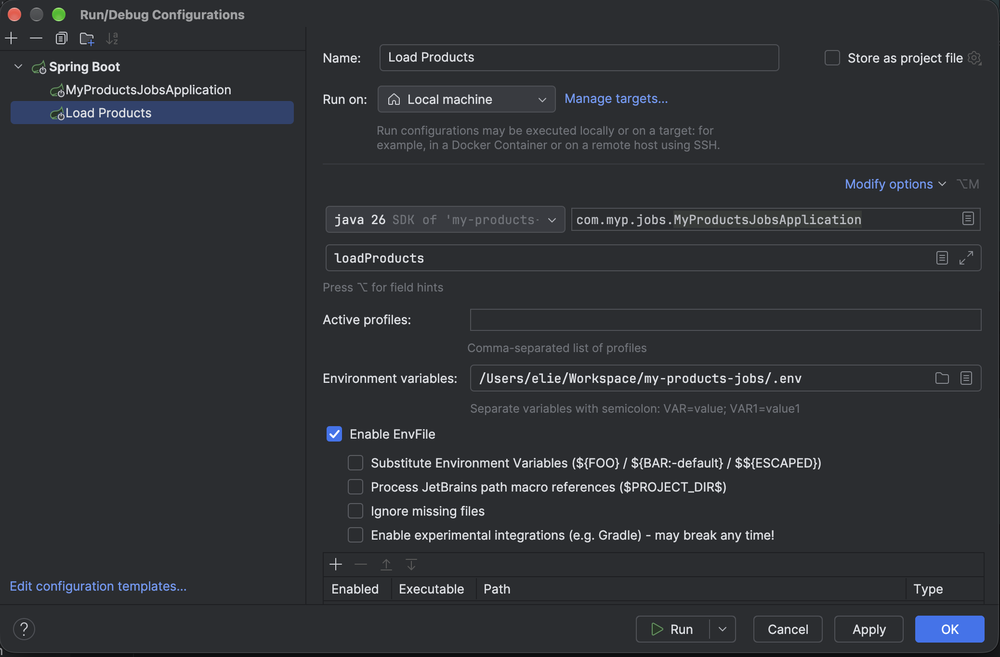

## Remove `spring-boot-starter-webmvc` dependency

```xml

<dependency>
    <groupId>org.springframework.boot</groupId>
    <artifactId>spring-boot-starter-webmvc</artifactId>
</dependency>
```

## Remove `springdoc-openapi-starter-webmvc-ui` dependency

Swagger UI only documents REST endpoints, so it has no purpose once they are gone.

```xml

<dependency>
    <groupId>org.springdoc</groupId>
    <artifactId>springdoc-openapi-starter-webmvc-ui</artifactId>
    <version>${spring.doc.version}</version>
</dependency>
```

## Add `spring-boot-starter` dependency

The core starter provides the Spring context, auto-configuration and logging, but no web server.

```xml

<dependency>
    <groupId>org.springframework.boot</groupId>
    <artifactId>spring-boot-starter</artifactId>
</dependency>
```

## Remove rest controller : `JobRest`

Just delete the java class

## Add `JobRunner` under `infrastructure/inbounb/cli/`

This is the new entry point, replacing the controller as the "inbound adapter". 

Spring calls `run` once the context is ready. It reads the first non-option argument as the job name and delegates to `JobService`.

```java

@Component
public class JobRunner implements ApplicationRunner {
    private final JobService jobService;

    public JobRunner(JobService jobService) {
        this.jobService = jobService;
    }

    @Override
    public void run(ApplicationArguments args) throws Exception {
        String jobName = args.getNonOptionArgs()
                .stream()
                .findFirst()
                .orElseThrow(() -> new IllegalArgumentException("Job name is required"));
        jobService.start(jobName);
    }
}
```

## Close on run

Without a web server, nothing keeps the JVM alive, but background threads, schedulers or connection pools can. 

Closing the context explicitly guarantees the application shuts down once the job finishes.

```java

@SpringBootApplication
public class MyProductsJobsApplication {
    public static void main(String[] args) {
        SpringApplication.run(MyProductsJobsApplication.class, args).close();
    }
}
```

## Pass the job name on launch

Add job name as a program argument

